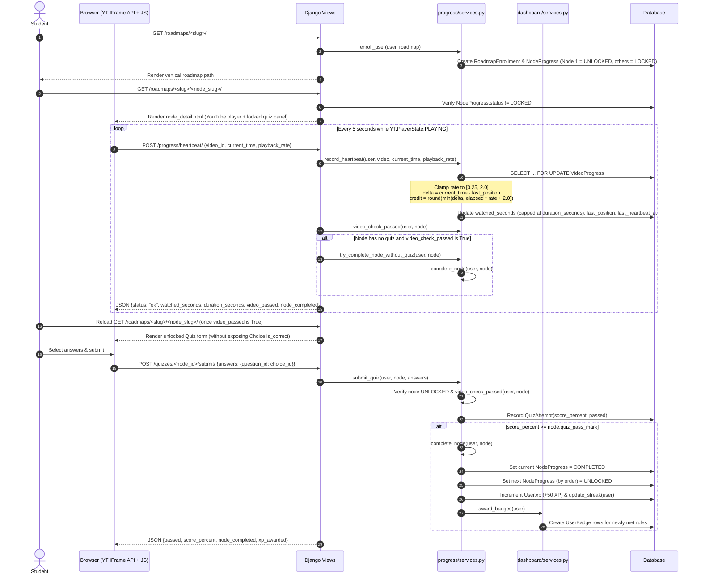

# Architecture — SkillMap (RoadmapLearn)

SkillMap is a server-rendered Django 6.x monolith where college students follow sequential career roadmaps (`roadmap.sh`-inspired topic paths) paired with embedded YouTube tutorials and anti-cheat verification.

---

## 1. Technology Stack

| Layer | Technology | Purpose |
|---|---|---|
| Runtime & Framework | Python 3.11+, Django 6.1.3 | Monolithic web framework, ORM, authentication, admin |
| Database | SQLite (dev) / PostgreSQL (prod via env vars) | Relational storage for users, roadmaps, progress, quizzes, notes, and badges |
| Templates & Styling | Django Templates, `static/css/app.css`, Tailwind Play CDN (`3.4.17`) | Server-rendered HTML with the "printed worksheet" design system |
| Client Interactivity | HTMX (`2.0.4`), YouTube IFrame Player API, vanilla `fetch` | Bookmark partial swapping, 5-second video playback heartbeats, debounced note saving, and quiz submission |
| Admin | Django Admin + `django-nested-admin` (`4.1.6`) | Single-page editing of `Node` → `Video` and `Quiz` → `Question` → `Choice` hierarchies; read-only audit views for student progress |

---

## 2. Application Structure

The project follows a strict **service-layer architecture**: views handle HTTP parsing, authentication, and rendering, while domain rules (unlocking, anti-cheat math, quiz grading, badge evaluation, search) live in each app's `services.py`.

```text
UptoSkillsInternship/
├── manage.py
├── roadmaplearn/                 # Project configuration & shared HTTP helpers
│   ├── settings.py               # Environment-driven settings & production security flags
│   ├── urls.py                   # Root URL routing
│   └── http.py                   # parse_json() and json_error() helpers
├── accounts/                     # Custom User model (xp, streak_days, last_active_date)
│   ├── models.py
│   ├── views.py                  # Signup view; Login/Logout via django.contrib.auth.views
│   └── urls.py
├── roadmaps/                     # Category, Roadmap, Node, Video, RoadmapBookmark
│   ├── models.py
│   ├── services.py               # search_roadmaps(), toggle_roadmap_bookmark()
│   ├── views.py                  # roadmap_list, saved_roadmaps, toggle_bookmark, roadmap_detail, node_detail
│   └── management/commands/
│       ├── seed_demo.py          # Demo roadmap seeder
│       ├── dump_playlist.py      # YouTube Data API v3 playlist dumper (stdlib urllib)
│       └── import_roadmap.py     # Offline transactional roadmap & quiz importer
├── progress/                     # RoadmapEnrollment, NodeProgress, VideoProgress
│   ├── models.py
│   ├── services.py               # enroll_user, record_heartbeat, video_check_passed, submit_quiz, complete_node, update_streak
│   ├── views.py                  # POST /progress/heartbeat/
│   └── management/commands/
│       └── demo_fastforward.py   # DEBUG-only helper to fast-forward a user to node N
├── quizzes/                      # Quiz, Question, Choice, QuizAttempt
│   ├── models.py
│   └── views.py                  # POST /quizzes/<node_id>/submit/
├── notes/                        # Per-user, per-node personal notes
│   ├── models.py
│   ├── services.py               # save_note() + badge evaluation hook
│   └── views.py                  # POST /notes/<node_id>/save/
├── dashboard/                    # Badge, UserBadge, streak & progress overview
│   ├── models.py
│   ├── services.py               # ensure_badges_seeded, award_badges, effective_streak, get_dashboard_data
│   ├── views.py                  # GET / (student dashboard)
│   └── management/commands/
│       └── seed_badges.py        # Idempotent 6-badge seeder
├── templates/                    # Global & app templates (base.html, 404.html, 500.html, etc.)
├── static/css/app.css            # Worksheet design system tokens & component classes
└── data/                         # Offline playlist dumps & roadmap JSON specs
```

---

## 3. Heartbeat-to-Unlock Request Flow

A node starts `LOCKED` (except the first node in a roadmap, which is `UNLOCKED` upon enrollment). To complete a node and unlock the next one in sequence, the student must pass both the **server-verified video watch check ($\ge 90\%$)** and the **node quiz ($\ge \text{quiz\_pass\_mark}\%$)**.


