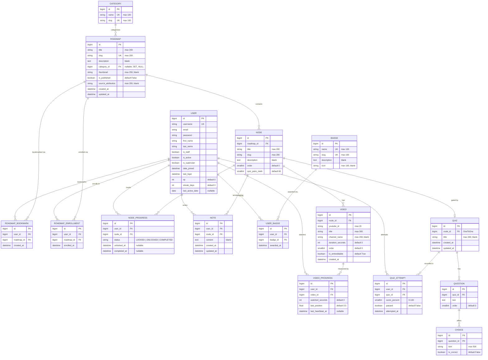

# Data Model — SkillMap (RoadmapLearn)

All 12 models across the 6 local Django apps (`accounts`, `roadmaps`, `progress`, `quizzes`, `notes`, `dashboard`) are shown below, generated directly from each app's `models.py`.

---

## 1. Entity-Relationship Diagram

---

## 2. Uniqueness Constraints & Indexes

| Model | App | `unique_together` / Unique Fields | Indexes |
|---|---|---|---|
| `User` | `accounts` | `username` | `["username"]`, `["email"]` |
| `Category` | `roadmaps` | `name`, `slug` | `["slug"]` |
| `Roadmap` | `roadmaps` | `slug` | `["slug"]`, `["is_published"]`, `["category"]` |
| `RoadmapBookmark` | `roadmaps` | `("user", "roadmap")` | `["user", "roadmap"]` |
| `Node` | `roadmaps` | `("roadmap", "order")`, `("roadmap", "slug")` | `["roadmap", "order"]` |
| `Video` | `roadmaps` | `("node", "order")` | `["node", "order"]`, `["youtube_id"]` |
| `RoadmapEnrollment` | `progress` | `("user", "roadmap")` | `["user", "roadmap"]` |
| `NodeProgress` | `progress` | `("user", "node")` | `["user", "node"]`, `["user", "status"]` |
| `VideoProgress` | `progress` | `("user", "video")` | `["user", "video"]` |
| `Quiz` | `quizzes` | `node` (`OneToOneField`) | PK / OneToOne index |
| `Question` | `quizzes` | — | `["quiz", "order"]` |
| `Choice` | `quizzes` | — | `["question", "is_correct"]` |
| `QuizAttempt` | `quizzes` | — | `["user", "quiz"]`, `["user", "passed"]` |
| `Note` | `notes` | `("user", "node")` | `["user", "node"]`, `["updated_at"]` |
| `Badge` | `dashboard` | `name`, `slug` | `["slug"]` |
| `UserBadge` | `dashboard` | `("user", "badge")` | `["user", "badge"]` |
